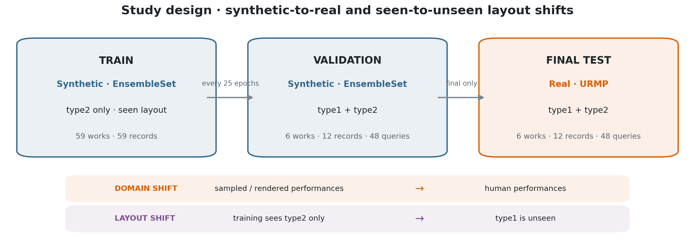
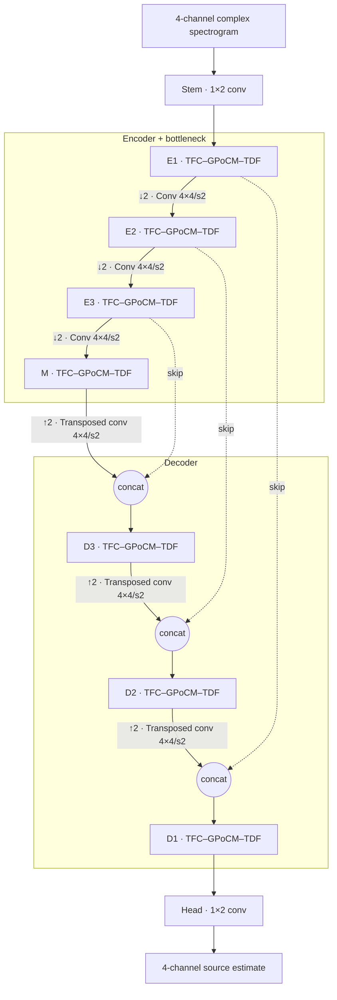
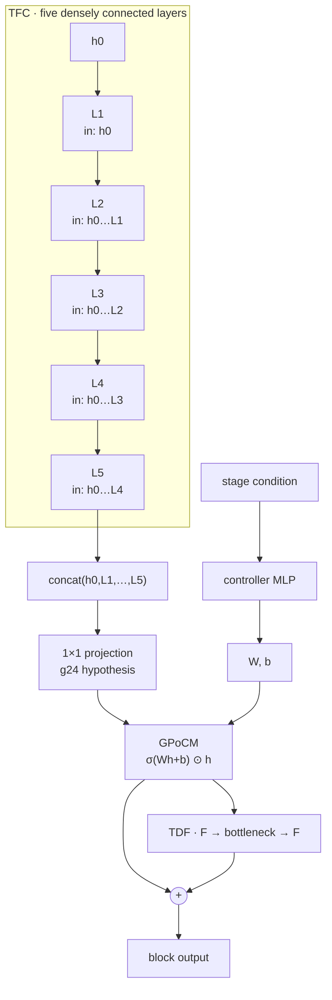
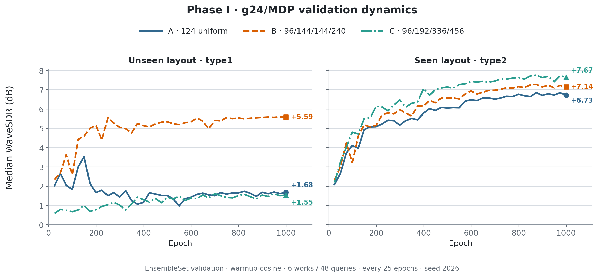
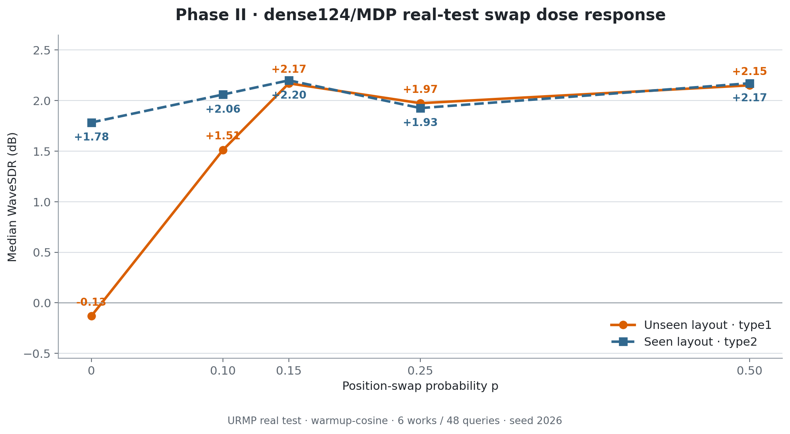
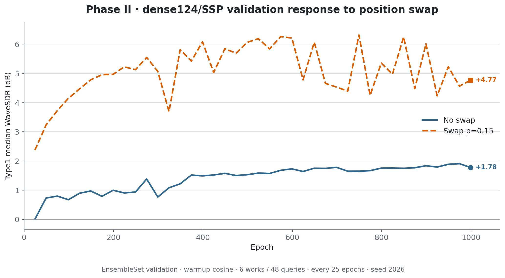
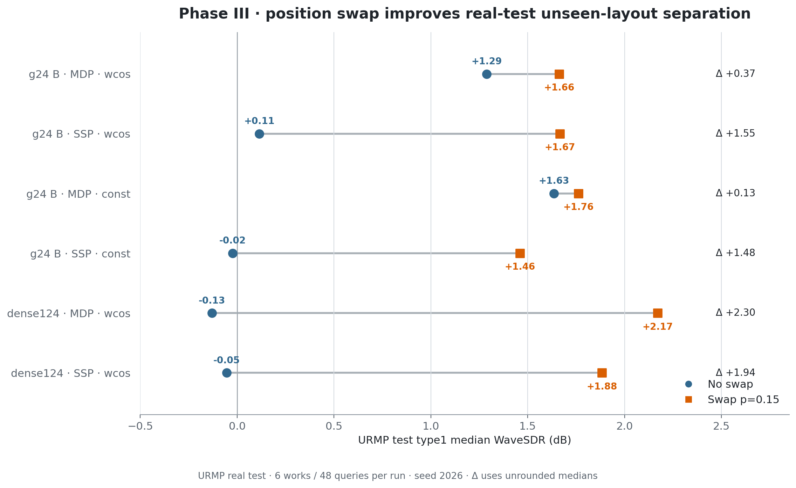
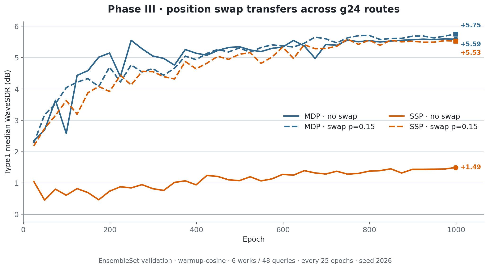
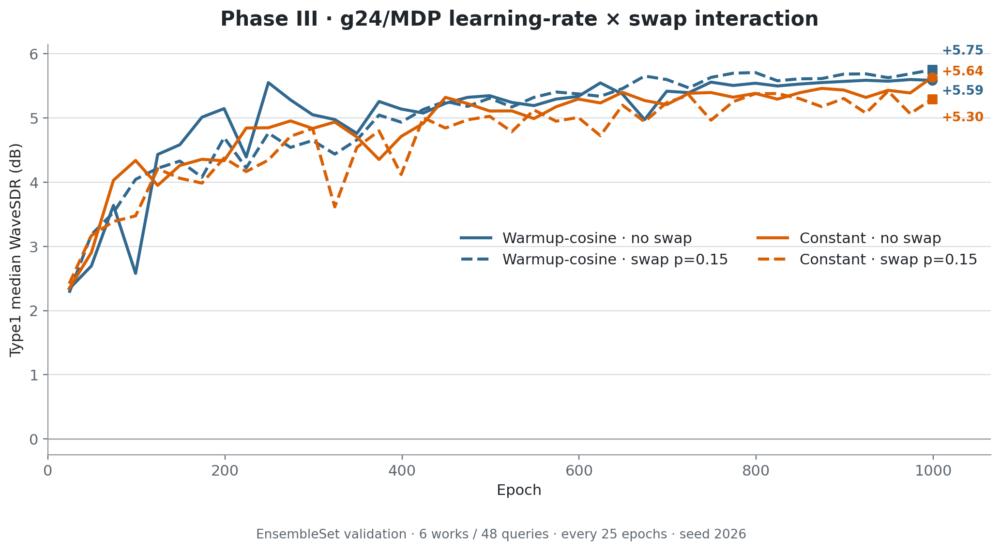

# From Synthetic to Real

## A Music Source Separation (MSS) Study of Positional Cues and Unseen Layouts

This repository studies one question:

> When a quartet separator is trained on synthetic performances in one seating arrangement, what transfers to real performances—and what fails when the seating combination changes?

The project begins with the public architectural clues in Xu et al., [*Position also matters! Separating Same Instruments in String Quartet using Timbral and Positional Cues*](https://www.isca-archive.org/interspeech_2025/xu25b_interspeech.pdf), reconstructs a family of plausible 7-block conditional U-Nets, and then uses two completed experiment matrices to study the compound **synthetic-to-real + seen-to-unseen-seating** shift.

The main empirical pattern is simple but important:

- On real URMP performances, the g24 base matrix is comparatively stable on the training-seen `type2` layout but unstable on the unseen `type1` layout.
- A historical dense124 architecture makes the same failure especially visible and therefore serves as an intervention-screening platform—not as a faithful reconstruction of the paper.
- Position-condition corruption, especially position swap, produces the strongest observed improvements in `type1` WaveSDR across both architecture families and both conditioning routes tested.
- These are exploratory, single-seed findings. They support a generalization hypothesis; they do not establish a causal mechanism or a statistically confirmed state of the art.

## Contents

1. [Research direction: synthetic to real](#1-research-direction-synthetic-to-real)
2. [Paper-constrained reconstruction of the 7-block model](#2-paper-constrained-reconstruction-of-the-7-block-model)
3. [Phase I: g24 reconstruction and generalization diagnosis](#3-phase-i-g24-reconstruction-and-generalization-diagnosis)
4. [Phase II: dense124 intervention screening](#4-phase-ii-dense124-intervention-screening)
5. [Phase III: cross-family transfer and observed improvements](#5-phase-iii-cross-family-transfer-and-observed-improvements)
6. [Two priorities for future work](#6-two-priorities-for-future-work)
7. [Scope, limitations, and artifact map](#7-scope-limitations-and-artifact-map)

---

## 1. Research direction: synthetic to real

### 1.1 Conditional quartet MSS

The input is a stereo quartet mixture containing violin 1, violin 2, viola, and cello. A query specifies a timbre class and a seating position; the model estimates the corresponding stereo source.

- Timbre ID: `{violin, viola, cello}`. Violin 1 and violin 2 share the violin timbre class.
- Position ID: one of four seating slots, `{0, 1, 2, 3}`.
- Query: `(timbre ID, position ID)`.

The two released layouts differ by exchanging violin 2 and cello:

| Seat | `type1` | `type2` |
|---:|---|---|
| 0 | violin 2 | cello |
| 1 | viola | viola |
| 2 | cello | violin 2 |
| 3 | violin 1 | violin 1 |

Training uses only `type2`. Therefore:

- real-domain `type2` tests **synthetic-to-real transfer with a seen seating combination**;
- real-domain `type1` adds an **unseen seating combination** to the same domain transfer.

This makes the `type2`/`type1` contrast a compact probe of combinatorial generalization under domain shift. It is not a clean causal decomposition—the audio content also changes between the synthetic and real sets—but it is more informative than one aggregate separation score.

### 1.2 What “synthetic to real” means here

The released SQR data construction uses sampled/synthetic EnsembleSet performances for train and validation and separately recorded human URMP parts for test. The sources are rendered into the specified stereo layouts with a measured B-format room impulse response. The main shift is therefore in the **source performance and timbre domain**—sampled/quantized performances versus human performances—rather than a simple comparison between artificial and natural reverberation.

The shift includes at least:

- sampled instruments versus physical instruments;
- quantized/synthetic timing and articulation versus human timing, intonation, and bowing;
- different source-recording characteristics and residual noise;
- a simultaneous change from a training-seen to a training-unseen part/seat combination for `type1`.

### 1.3 Auditable data split

| Split | Source domain | Unique works | Rendered records | Layouts | Queries |
|---|---|---:|---:|---|---:|
| Train | EnsembleSet-derived synthetic performances | 59 | 59 | `type2` only | 236 per epoch |
| Validation | EnsembleSet-derived synthetic performances | 6 | 12 | `type1` + `type2` | 48 |
| Test | URMP human performances | 6 | 12 | `type1` + `type2` | 48 |

There is no composition overlap between these splits. The project follows the checked-in manifests in [`manifests/`](manifests/): 59 released EnsembleSet works for training and 6 for validation. The counts described in the paper, the released 65-work archive, and a possible train/validation interpretation do not uniquely reconcile; the manifests are therefore the operational source of truth for this independent implementation.

The overview below makes the two simultaneous shifts explicit: train/validation use synthetic EnsembleSet performances while the final test uses real URMP performances; training exposes `type2` only, while validation and test include both layouts.



### 1.4 WaveSDR: the metric used in this repository

This project evaluates the reconstructed full-length waveform with the following scale-dependent energy ratio:

```math
\mathrm{WaveSDR}(x, \hat{x})
=10\log_{10}\left(
\frac{\sum_n x_n^2}
{\sum_n(\hat{x}_n-x_n)^2+10^{-8}}
\right).
```

where $x$ is the reference waveform and $\hat{x}$ is the estimated waveform. Higher is better.

Every reported number was produced by the versioned compatibility protocol `legacy_v1`, which is now selected explicitly by every checked-in config and implemented once in [`src/sqr_repro/evaluation.py`](src/sqr_repro/evaluation.py). It preserves the historical evaluation path rather than retroactively changing the results:

- a segment contains `(num_frames - 1) × hop_length` waveform samples;
- the overlap-add stride is `int(segment_samples × (1 - 0.5))`, with no rounding to an STFT-hop multiple;
- each segment uses `torch.hann_window(..., periodic=True)`, and the accumulated blend weights are clamped to a minimum of `1e-8` before division;
- an input shorter than one segment is padded for inference, while scoring uses the common available estimate/reference length.

Important boundaries:

- WaveSDR is computed directly in the waveform domain.
- It is **scale dependent**: a gain mismatch is counted as error.
- It is **not SI-SDR** and should not be labelled SI-SDR.
- It is also not guaranteed to match the BSS Eval-style SDR used by the paper. The results below are internally comparable because they share one implementation, but their absolute values must not be compared numerically with the paper until the evaluation definitions are aligned.
- `type1 median` and `type2 median` are each computed over 24 queries; `test mean` is computed over all 48 test queries.

---

## 2. Paper-constrained reconstruction of the 7-block model

### 2.1 What the paper makes public

The paper provides enough information to constrain a model family, but not enough to identify one unique implementation.

| Public clue | Interpretation used here |
|---|---|
| U-Net-like separator with 7 blocks | 3 encoder blocks, 1 middle block, and 3 decoder blocks |
| Stereo complex spectrogram | real/imaginary components of left/right channels are packed as 4 feature channels |
| Input/output convolutions | an initial and a final `1×2` convolution surround the 7 blocks |
| TFC-TDF backbone | every principal block contains a densely connected time-frequency convolution stack and a frequency transform |
| TFC specification | 5 dense `3×3` convolutional layers, growth rate 24 |
| Conditional modulation | a condition-generated GPoCM gate modulates block features |
| Conditions | 32-dimensional timbre and position embeddings; `e_m = 0.5(e_t + e_p)` |
| Best route reported in §4.2 | encoder ← `e_t`, middle ← `e_m`, decoder ← `e_p` |
| Model size | approximately 46M parameters, reported as a rounded total |

### 2.2 Architecture in two compact views

The architecture is split into two figures so that network topology and block internals can be read independently.

#### Seven-block U-Net topology and resolution changes

The seven principal blocks are `E1 → E2 → E3 → M → D3 → D2 → D1`. Each decoder receives the upsampled lower-resolution feature concatenated with the encoder feature at the same resolution.



STFT packing occurs before this graph; complex unpacking and iSTFT occur after it. Down/up operators include batch normalization and ReLU in this repository. Their exact kernels are disclosed implementation choices, not uniquely determined by the paper.

#### Inside one TFC–GPoCM–TDF block

Every TFC layer is `3×3 convolution → batch normalization → ReLU`. Layer $L_i$ receives the concatenation of the block input and all earlier TFC outputs. The compact labels below show those dense inputs without drawing every redundant edge.



### 2.3 Conditioning routes

Timbre and position use separate 32-dimensional embeddings, with `e_m = 0.5(e_t + e_p)`. A controller converts the selected embedding into the stage-specific channel-mixing matrix `W` and bias `b`.

| Route | Encoder `E1–E3` | Middle `M` | Decoder `D3–D1` | Role in this study |
|---|---|---|---|---|
| `split_stage_paper` (SSP) | `e_t` | `e_m` | `e_p` | paper-preferred route reported in §4.2 |
| `mid_dual_paper` (MDP) | unconditioned | unconditioned | `e_m` | paper-described decoder route in §3.2 and Fig. 2 |

`MDP` is this repository's shorthand rather than an acronym used verbatim in the paper. It denotes the §3.2/Fig. 2 topology, where the averaged timbre-position embedding conditions GPoCM at decoder levels. Section 4.2 further reports that assigning `e_t` to the encoder, `e_m` to the middle, and `e_p` to the decoder performed best; this repository calls that second route SSP.

### 2.4 GPoCM equation and implementation boundary

For feature map $D^i$ at stage $i$, the implemented gate follows the published form:

```math
\begin{aligned}
\mathrm{PoCM}(D^i_c)
&=\sum_j \omega^i_{cj}D^i_j+\beta^i_c, \\
\mathrm{GPoCM}(D^i_c)
&=\sigma\!\left(\mathrm{PoCM}(D^i_c)\right)\odot D^i_c.
\end{aligned}
```

The repository applies GPoCM after TFC and before TDF, then returns `h + TDF(h)`. The g24 family concatenates the dense input and all five growth-24 outputs and projects them to the stage width with `1×1` convolution. This projection is an explicit reconstruction hypothesis, not a detail claimed to be present in the authors' model.

### 2.5 From unpublished choices to completed experiments

The repository turns the most consequential open questions into four completed comparisons:

| Research question | Completed comparison | Role in this study |
|---|---|---|
| Which growth-24 network is compatible with the rounded 46M clue? | g24 candidates A / B / C | tests three channel/controller allocations |
| Where should timbre and position cues enter the network? | SSP vs MDP for every g24 candidate | tests conditioning-route sensitivity |
| Does the unreported learning-rate schedule matter? | constant `5e-4` vs warmup-cosine | tests optimization sensitivity |
| Can the observed `type2 → type1` gap be reduced? | dense124 baseline, noise, drop, swap, and gate-invariance runs | screens intervention mechanisms |

The first three comparisons form the 12-cell g24 matrix in Section 3; the fourth is the dense124 screen in Section 4. TDF details, down/up operators, data manifests, and WaveSDR are fixed disclosed choices rather than experimental axes. The matrices should therefore be read as tests of explicit hypotheses, not as evidence that one row recovers the unpublished original model.

### 2.6 Completed experiment status

| Experiment family | Result-bearing cells | Status |
|---|---:|---|
| g24 architecture × route × LR | 12 / 12 | ✅ Completed |
| dense124 route × LR | 4 / 4 | ✅ Completed |
| dense124 intervention screen | 7 / 7 | ✅ Completed |
| Cross-route / cross-schedule swap follow-ups | 6 / 6 | ✅ Completed |

### 2.7 Shared training protocol for reported runs

All result-bearing runs reported in Sections 3–5 use the following training protocol. The GPU entry records the reference environment used to produce these results; it is not a hardware requirement.

| Item | Setting |
|---|---|
| Reference hardware | NVIDIA V100S 32 GB; observed usage 10–24 GB depending on architecture |
| Precision | FP32 |
| Batch size | 4 |
| Training budget | 1000 epochs = 59,000 optimizer updates (59 updates per epoch) |
| Optimizer | Adam, learning rate `5e-4`, betas `[0.9, 0.999]`, epsilon `1e-8`, weight decay `0` |
| LR schedule | Constant or 500-update warmup followed by cosine decay |
| Training crop | 128 frames for g24; 176 frames for dense124 |
| Random seed | 2026 (single seed) |
| Validation | Every 25 epochs, using full-length WaveSDR on 12 validation records |

See [`REPRODUCIBILITY.md`](REPRODUCIBILITY.md) for the complete execution and evaluation protocol and [`ENVIRONMENT.md`](ENVIRONMENT.md) for the recorded software stack.

The experimental narrative that follows is deliberately sequential: Phase I reconstructs and diagnoses, Phase II screens possible remedies, and Phase III tests whether the selected improvements transfer beyond the screening setup.

---

## 3. Phase I: g24 reconstruction and generalization diagnosis

This phase is the paper-constrained reconstruction stage. The g24 family preserves the published growth rate and rounded parameter-count clue while treating unpublished architectural choices as explicit candidates. Its purpose is to determine what can be reconstructed from the public evidence and then identify the generalization failure that appears when models trained on synthetic `type2` are evaluated on real `type1`.

### 3.1 Three growth-24 candidates

All three SSP candidates use the paper-specified TFC growth rate 24 and are tuned to the paper's rounded 46M parameter clue. They differ in where that capacity is placed.

| Candidate | Stage widths | Controller hidden widths | SSP parameters | MDP parameters |
|---|---|---|---:|---:|
| A | 124 / 124 / 124 / 124 | 64 → 128 → 384 | 45,750,952 | 21.76M |
| B | 96 / 144 / 144 / 240 | 64 → 128 → 256 | 46,017,316 | 17.94M |
| C | 96 / 192 / 336 / 456 | 64 → 128 → 64 | 46,039,900 | 22.08M |

Removing encoder and middle controllers makes MDP substantially smaller, so the 46M match applies to the SSP versions, not to every route.

The matrix crosses:

- architecture: A, B, C;
- condition route: SSP or MDP;
- learning rate: constant `5e-4` (`const`) or 500-update warmup followed by cosine decay (`wcos`).

No condition corruption is used in this base matrix. **Status: ✅ all 12 runs completed.**

### 3.2 Real-test WaveSDR matrix

Each cell is `type1 median / type2 median` WaveSDR in dB.

| Architecture | SSP / const | SSP / wcos | MDP / const | MDP / wcos |
|---|---:|---:|---:|---:|
| A | −0.32 / +1.67 | −0.30 / +1.53 | +0.35 / +1.59 | +0.06 / +1.70 |
| B | −0.02 / +1.65 | +0.11 / +1.45 | **+1.63 / +1.74** | **+1.29 / +1.53** |
| C | −0.14 / +1.72 | +0.15 / +1.56 | −0.37 / +1.80 | −0.14 / +1.75 |

### 3.3 What the matrix reveals

Across all 12 base runs:

- `type2` remains within a relatively narrow, positive interval: **+1.45 to +1.80 dB**;
- `type1` ranges from **−0.37 to +1.63 dB** and changes sharply with architecture and route;
- B/MDP is the strongest no-intervention combination under both LR schedules, but several other cells are slightly positive—so the correct conclusion is not “only B/MDP works”; it is that robust `type1` transfer is highly configuration dependent;
- neither a rounded 46M parameter match nor the paper-preferred route is sufficient by itself to guarantee unseen-layout transfer.

Because training sees synthetic `type2` only, these results separate two empirical situations:

1. **Synthetic → real, seen combination (`type2`)**: transfer is imperfect but comparatively stable.
2. **Synthetic → real, unseen combination (`type1`)**: the additional compositional shift is fragile and route dependent.

This is the central problem that motivates the dense124 intervention screen.

#### Validation curves: type1 fragility vs type2 stability

The architecture split emerges during training, not only at the final checkpoint. The figure below shows validation type1 and type2 curves for the three g24 candidates under MDP/wcos:



At epoch 999, validation `type1` is +5.59 dB for B but only +1.68 and +1.55 dB for A and C. Validation `type2` remains high for all three (+6.73 to +7.67 dB). This synthetic validation contrast isolates sensitivity to the unseen layout; the real-test matrix above shows that the problem persists when the domain shift is added.

---

## 4. Phase II: dense124 intervention screening

This phase turns from reconstruction to solution search. Dense124 is not presented as a faithful version of the paper; its larger baseline `type2`/`type1` discrepancy makes it a high-contrast platform for screening position noise, drop, swap, and gate-invariance interventions before testing them more broadly.

### 4.1 Why dense124 is not a paper reconstruction

The historical dense124 architecture uses uniform width 124 and **TFC growth rate 124**. Its SSP variant has **46.46M parameters**, close to the paper's rounded 46M count, but the paper explicitly reports growth rate 24. Matching one scalar parameter total does not make the architecture paper-faithful.

More precisely:

- dense124/SSP: 46.46M parameters, growth 124;
- dense124/MDP: 30.44M parameters because encoder and middle controllers are absent;
- dense124 returns the final dense layer rather than using the g24 concat-plus-projection rule;
- dense124 uses 176-frame training crops, whereas g24 uses 128-frame crops.

Therefore dense124 is used here as an **intervention-selection platform**: its large `type2`/`type1` discrepancy makes it useful for testing ways to improve unseen-layout generalization. Direct numerical comparisons between dense124 and g24 remain confounded by architecture and crop length.

### 4.2 Base dense124 route × LR matrix

Each cell is `type1 median / type2 median` WaveSDR in dB. **Status: ✅ all 4 runs completed.**

| Route | Constant LR | Warmup-cosine |
|---|---:|---:|
| MDP | −0.34 / +2.08 | −0.13 / +1.78 |
| SSP | −0.41 / +2.29 | −0.05 / +1.75 |

The matched-layout real score is positive in every cell, while unseen-layout `type1` is negative in every cell. This is a sharper version of the g24 pattern and provides a useful baseline for intervention screening.

### 4.3 Completed intervention screen

The screen uses dense124/MDP with warmup-cosine unless otherwise noted. Position swap leaves the mixture, target, and timbre ID unchanged; with probability $p$ for a training batch, it globally permutes the four position IDs. Thus the position label becomes an unreliable cue on a controlled fraction of updates.

| Intervention | Test `type1` median | Test `type2` median | Test mean | Status |
|---|---:|---:|---:|---|
| None | −0.13 | +1.78 | +1.32 | ✅ Completed |
| Position-embedding noise, σ = 0.10 | +0.43 | +1.24 | +0.79 | ✅ Completed |
| Position-embedding drop, p = 0.25 | +0.34 | +1.69 | +1.01 | ✅ Completed |
| Position swap, p = 0.10 | +1.51 | +2.06 | +1.99 | ✅ Completed |
| **Position swap, p = 0.15** | **+2.17** | **+2.20** | +2.25 | ✅ Completed |
| Position swap, p = 0.25 | +1.97 | +1.93 | **+2.35** | ✅ Completed |
| Position swap, p = 0.50 | +2.15 | +2.17 | +2.22 | ✅ Completed |
| Gate-invariance regularization, λ = 1.0 | +1.81 | +2.13 | +2.24 | ✅ Completed |

The table uses the final 48-query summaries stored in [`results/`](results/). The p=0.25 and gate-invariance final summaries are retained in [`results/historical_test_results/`](results/historical_test_results/); the remaining rows have canonical per-run `test_results.json` files.

The dense124/MDP real-test dose response makes the main pattern easier to see:



Most of the `type1` gain appears by p=0.10, and `type1` nearly matches `type2` at p=0.15. Results remain similar at p=0.25 and p=0.50, supporting a broad effective range rather than a sharply identified optimum.

### 4.4 What the screen supports

- Position swap gives the largest `type1` gains in this screen and also preserves or improves the overall mean at the tested doses.
- Gate-invariance regularization also improves both `type1` and the overall mean; swap is therefore not the only effective intervention.
- Noise and drop improve `type1` modestly but reduce the mean, which is consistent with generic regularization rather than a clean resolution of the combination problem.
- These outcomes are **consistent with** reduced dependence on the fixed part/seat association. They do not prove that the network learned to “verify the label from audio”; that causal explanation requires counterfactual tests.

#### Validation view: the same intervention under SSP

The dose-response figure above uses dense124/MDP test results. As a complementary check, the figure below compares dense124/SSP validation `type1` with and without swap:



The no-swap run finishes at +1.78 dB. Swap p=0.15 remains higher at every recorded checkpoint, peaks at +6.31 dB, and finishes at +4.77 dB. The trajectory is clearly improved but not monotonic; it should be read as supporting evidence for the intervention, not as proof of a particular learning mechanism.


---

## 5. Phase III: cross-family transfer and observed improvements

This phase combines the two lines of evidence. Interventions selected with dense124 are transferred back to g24 and tested across conditioning routes and learning-rate schedules; improvements that recur across these settings are more informative than gains confined to the screening architecture.

### 5.1 Does swap transfer across architecture and route?

The same p=0.15 idea was tested beyond the dense124/MDP screening cell. Values are test `type1` median and all-query mean WaveSDR.

| Architecture / route / LR | No-swap `type1` | Swap-0.15 `type1` | Δ `type1` | No-swap mean | Swap mean | Status |
|---|---:|---:|---:|---:|---:|---|
| g24 B / MDP / wcos | +1.29 | +1.66 | +0.37 | +1.80 | +2.07 | ✅ Completed |
| g24 B / SSP / wcos | +0.11 | +1.67 | +1.55 | +1.06 | +2.17 | ✅ Completed |
| g24 B / MDP / const | +1.63 | +1.76 | +0.13 | +1.97 | +2.19 | ✅ Completed |
| g24 B / SSP / const | −0.02 | +1.46 | +1.48 | +1.07 | +2.10 | ✅ Completed |
| dense124 / MDP / wcos | −0.13 | +2.17 | +2.30 | +1.32 | +2.25 | ✅ Completed |
| dense124 / SSP / wcos | −0.05 | +1.88 | +1.94 | +1.29 | +2.19 | ✅ Completed |

The Δ column is computed from unrounded medians, so it can differ by 0.01 dB from subtracting the two displayed endpoint values.

The paired real-test view summarizes the same six comparisons:



The p=0.15 change is positive in all six comparisons and is largest when the no-swap baseline is weakest, especially for SSP and dense124. This recurrence is more informative than any single gain, but the single-seed differences are not significance-tested effects.

#### Validation view: route transfer on g24 B

The corresponding synthetic-validation trajectories show why the real-test gains differ by route:



At epoch 999, MDP changes from +5.59 to +5.75 dB, whereas SSP changes from +1.49 to +5.53 dB. These are synthetic-validation values, not the real-test values above; their role is to show that the intervention also changes the route-dependent training outcome.

#### Validation view: LR schedule × swap interaction

The final validation ordering is not identical to the real-test ordering:



At epoch 999, warmup-cosine changes from +5.59 to +5.75 dB with swap, while constant LR changes from +5.64 to +5.30 dB. On the real test, however, both paired changes are positive (+0.37 and +0.13 dB respectively). This distinction prevents the validation curve from being over-interpreted: the main transfer claim comes from the paired real-test results, not from a uniformly higher final validation point.

Under constant LR, g24 B/MDP was also completed with swap p=0.25: `type1 = +1.74`, `type2 = +1.86`, and `mean = +2.23` dB. The similar p=0.15 and p=0.25 `type1` values do not support a sharp optimum in the g24 family.

### 5.2 Best observed results

| Selection criterion | Configuration | `type1` median | `type2` median | Test mean |
|---|---|---:|---:|---:|
| **Best unseen-layout result** | dense124 / MDP / wcos / swap p=0.15 | **+2.17** | +2.20 | +2.25 |
| **Best all-query mean** | dense124 / MDP / wcos / swap p=0.25 | +1.97 | +1.93 | **+2.35** |
| **Best growth-24 `type1` result** | g24 B / MDP / const / swap p=0.15 | **+1.76** | +2.05 | +2.19 |

“Best” means the largest observed value among the completed runs in this repository. It does not mean statistically superior: all headline runs use seed 2026 and the same six URMP test works.

### 5.3 What can be concluded

1. The g24 search shows that paper-compatible growth-24 implementations can have similar `type2` performance but very different `type1` performance. Hidden architectural choices matter most for the unseen combination.
2. The dense124 search shows that a rounded 46M match alone is not meaningful: its growth-124 SSP model matches the count yet fails the unmodified `type1` test.
3. Across the tested configurations, moderate corruption of the position condition is a promising way to improve real-domain unseen-layout performance. The evidence is broad across routes and schedules, but remains exploratory because it is based on one seed and a repeatedly consulted test set.

---

## 6. Two priorities for future work

The completed matrices expose two limits that matter more than adding another architecture cell.

### Direction 1 — Build higher-quality, repertoire-faithful synthetic data

The released synthetic corpus is useful for controlled experiments, but its performance realism and repertoire fidelity remain limited. Using a strict catalogue rule—an original work for the standard two-violin, viola, and cello quartet, rather than a work merely arranged or rendered with those four parts—an audit of the checked-in [`manifests/`](manifests/) against the public [EnsembleSet metadata](https://docs.google.com/spreadsheets/d/1Trq9DVDYXseofa9iEYtMiAcrNBP6WoNBND4H3BrzUyo/edit?usp=sharing) and [URMP catalogue](https://labsites.rochester.edu/air/projects/URMP/URMP_doc.pdf) gives:

| Split | Distinct `composition_id` entries | Strict string-quartet entries | Share |
|---|---:|---:|---:|
| Train | 59 | 19 | 32.2% |
| Validation | 6 | 2 | 33.3% |
| Test | 6 | 0 | 0.0% |

The train count covers quartet entries by Mozart, Haydn, Donizetti, Beethoven, and Schubert; K.465 appears in two dataset entries, so the 19 entries represent 18 distinct underlying works. The two validation works are Mozart K.464 and Borodin String Quartet No. 2. The test selections are arrangements or works from other ensemble genres—including *The Art of Fugue* and the string quintet K.515—so none meets the strict original-quartet criterion.

A stronger synthetic-to-real benchmark should therefore curate genre-faithful scores, use more expressive timing, dynamics, articulation, and room variation, enforce work/composer-disjoint splits, and include real performances of original string-quartet repertoire in validation and test.

**Question answered:** How much of the transfer gap can be reduced by improving both synthesis quality and repertoire match?

### Direction 2 — Build a multidimensional separation-quality framework

WaveSDR provides a consistent scalar comparison, but it cannot by itself distinguish target distortion, source leakage, timbral or spectral damage, transient smearing, and stereo-image errors. Future evaluation should combine waveform metrics such as WaveSDR and SI-SDR, interference/artifact decomposition, multi-resolution spectral and music-structure measures, stereo/spatial consistency checks, and blinded expert listening tests. Results should be reported per work, part, and layout with confidence intervals and representative failure-case audio.

**Question answered:** Do higher separation scores correspond to perceptually and musically better outputs, and which failure modes remain?

---

## 7. Scope, limitations, and artifact map

### 7.1 Claim boundaries

- This is an **exploratory independent reimplementation**, not the authors' released model and not an exact replication.
- The paper does not disclose enough layer-level detail to identify one unique 46M network; A/B/C are explicit hypotheses.
- WaveSDR is an internal project metric and is not directly comparable with the paper's SDR.
- Headline experiments use one seed (`2026`), six URMP works, and 48 test queries.
- Because the same real test set was used to compare many choices, it functions partly as a development benchmark. Reported best values require independent confirmation.
- Cross-family g24/dense124 comparisons are not controlled for crop length, dense-block convention, growth rate, or parameter allocation.

### 7.2 Repository map

| Path | Contents |
|---|---|
| [`src/sqr_repro/models/`](src/sqr_repro/models/) | separator, TFC/TDF blocks, embeddings, controllers, and GPoCM |
| [`src/sqr_repro/evaluation.py`](src/sqr_repro/evaluation.py) | shared `legacy_v1` full-track inference, WaveSDR, and aggregation |
| [`configs/`](configs/) | completed experiment definitions |
| [`manifests/`](manifests/) | operational train/validation/test splits |
| [`results/`](results/) | final per-run test summaries and training/validation records |
| [`figures/`](figures/) | README figures in PNG and SVG formats |
| [`scripts/`](scripts/) | training, evaluation, audit, manifest, and figure-generation utilities |
| [`DATA.md`](DATA.md) | data acquisition and layout notes |
| [`REPRODUCIBILITY.md`](REPRODUCIBILITY.md) | environment and execution details |
| [`ENVIRONMENT.md`](ENVIRONMENT.md) | recorded software/hardware environment |

### 7.3 Primary references

- Yuetonghui Xu et al., [*Position also matters! Separating Same Instruments in String Quartet using Timbral and Positional Cues*](https://www.isca-archive.org/interspeech_2025/xu25b_interspeech.pdf), Interspeech 2025, [DOI: 10.21437/Interspeech.2025-130](https://doi.org/10.21437/Interspeech.2025-130).
- [StringQuD reverb two-seating release](https://doi.org/10.5281/zenodo.14793971).
- [URMP dataset](https://labsites.rochester.edu/air/projects/URMP.html).

---

## Bottom line

The paper's public clues define a compelling conditional-separation idea, but not a uniquely reproducible network. Treating the missing details as experimental variables reveals the more durable result: under a synthetic-to-real shift, performance on a training-seen seating arrangement can conceal failure on an unseen arrangement. In this exploratory study, weakening the reliability of the position condition—especially through moderate position swap—substantially improves that unseen-layout behavior without requiring a claim that any one candidate exactly matches the unpublished original model.
